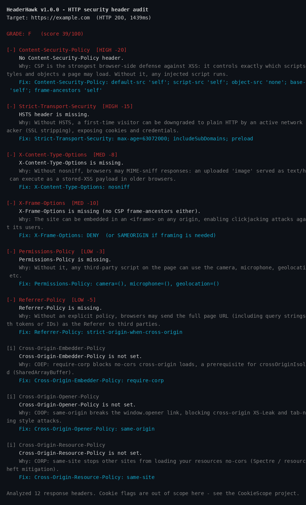

# HeaderHawk

Audit a site's HTTP security headers, grade them **A+..F**, and get the exact
header to add for every miss. Two modes: **live** (fetch a URL) and
**offline** (analyze headers saved from curl / Burp / ZAP without touching the
network again).

> **In simple words:** every website sends invisible name tags with each reply.
> HeaderHawk reads them, grades the site's safety setup from A+ to F, and tells
> you exactly which tags to add.

Stdlib-only Python. No dependencies, no API keys, nothing to install beyond
Python 3.9+.

Pairs well with [Xploit](https://github.com/harshzagade/Xploit): Xploit finds
the bugs, HeaderHawk hardens the headers.

## Install

```bash
git clone https://github.com/harshzagade/HeaderHawk.git
cd HeaderHawk
pip install .          # or: pip install -e .
```

Or run it straight from the source tree without installing:

```bash
python3 -m headerhawk.cli https://example.com
```

## Usage

```bash
# Live audit of a site (https:// is assumed if you omit the scheme)
headerhawk example.com

# Fully offline: analyze headers saved earlier (curl -i, Burp, ZAP...)
headerhawk --headers response-headers.txt
curl -sI https://example.com | headerhawk --json

# Machine-readable report for piping into other tools
headerhawk example.com --json | jq .grade

# CI gate: exit 1 unless the grade is at least B
headerhawk example.com --fail-below B

# One-line summary (grade, score, host) for status bars / CI matrices
headerhawk example.com --summary-line
# A+ 100 example.com

# Plain-English explainer for non-security teammates: only HIGH findings,
# each with "what it means" and "what to do" notes plus a summary paragraph
headerhawk example.com --explain HIGH

# See the raw headers too
headerhawk example.com --raw

# Save the report
headerhawk example.com -o report.txt

# Bulk mode: audit a list of targets (one URL per line, # comments ok),
# print a summary grade table (unreachable targets show as ERROR rows)
headerhawk --bulk targets.txt
headerhawk --bulk targets.txt --json | jq '.targets[].grade'

# Compare two targets side by side (before/after hardening checks):
# shows regressed, new, resolved, and improved findings
headerhawk --compare http://staging.example.com https://example.com

# Same diff, but hide INFO/OK-only changes so reviews focus on real changes
headerhawk --compare http://staging.example.com https://example.com --ignore-info

# Compare against a saved --json baseline instead of a second live URL
# (drift detection for CI / post-deploy checks; same diff output)
headerhawk https://example.com --diff-against baseline.json

# Watch mode: re-audit every 60 seconds, alerting only when the grade or
# findings change (for monitoring your own site after deploys)
headerhawk example.com --watch 60

# Watch mode with an audit trail: append timestamped baseline, change alerts,
# fetch gaps, and stop events to a log file (overnight runs)
headerhawk example.com --watch 60 --watch-log watch.log

# Subresource Integrity audit: fetch the page HTML and flag external
# scripts/stylesheets loading without an integrity= hash (MED, -4 each)
headerhawk example.com --sri

# Grade history: record one (timestamp, url, grade, score) row per audit,
# then print the trend over time
headerhawk example.com --history grades.jsonl
headerhawk --history-report grades.jsonl
```

Options: `--timeout SEC`, `--tls-timeout SEC`, `--user-agent UA`, `--no-color`, `--no-tls`,
`-o/--output FILE`,
`--fail-below GRADE`, `--only SEV`, `--explain SEV`, `--summary-line`,
`--sri`, `--history FILE`, `--history-report FILE`, `--bulk FILE`,
`--compare URL_A URL_B`, `--diff-against FILE`,
`--watch SEC`, `--watch-log FILE`, `--version`. Run
`headerhawk --help` for the full list.

## Sample output

`headerhawk https://example.com` (real run):

```
HeaderHawk v1.0.0 - HTTP security header audit
Target: https://example.com  (HTTP 200, 411ms)

GRADE: F   (score 39/100)

[-] Content-Security-Policy  [HIGH -20]
    No Content-Security-Policy header.
    Why: CSP is the strongest browser-side defense against XSS: it controls exactly which scripts, styles and objects a page may load. Without it, any injected script runs.
    Fix: Content-Security-Policy: default-src 'self'; script-src 'self'; object-src 'none'; base-uri 'self'; frame-ancestors 'self'

[-] Strict-Transport-Security  [HIGH -15]
    HSTS header is missing.
    Why: Without HSTS, a first-time visitor can be downgraded to plain HTTP by an active network attacker (SSL stripping), exposing cookies and credentials.
    Fix: Strict-Transport-Security: max-age=63072000; includeSubDomains; preload

[-] X-Content-Type-Options  [MED -8]
    X-Content-Type-Options is missing.
    Why: Without nosniff, browsers may MIME-sniff responses: an uploaded 'image' served as text/html can execute as a stored-XSS payload in older browsers.
    Fix: X-Content-Type-Options: nosniff

[-] X-Frame-Options  [MED -10]
    X-Frame-Options is missing (no CSP frame-ancestors either).
    Why: The site can be embedded in an <iframe> on any origin, enabling clickjacking attacks against its users.
    Fix: X-Frame-Options: DENY  (or SAMEORIGIN if framing is needed)

[-] Permissions-Policy  [LOW -3]
    Permissions-Policy is missing.
    Why: Without it, any third-party script on the page can use the camera, microphone, geolocation, etc.
    Fix: Permissions-Policy: camera=(), microphone=(), geolocation=()

[-] Referrer-Policy  [LOW -5]
    Referrer-Policy is missing.
    Why: Without an explicit policy, browsers may send the full page URL (including query strings with tokens or IDs) as the Referer to third parties.
    Fix: Referrer-Policy: strict-origin-when-cross-origin

[i] Cross-Origin-Embedder-Policy
    Cross-Origin-Embedder-Policy is not set.
    Why: COEP: require-corp blocks no-cors cross-origin loads, a prerequisite for crossOriginIsolated (SharedArrayBuffer).
    Fix: Cross-Origin-Embedder-Policy: require-corp

[i] Cross-Origin-Opener-Policy
    Cross-Origin-Opener-Policy is not set.
    Why: COOP: same-origin breaks the window.opener link, blocking cross-origin XS-Leak and tab-nabbing style attacks.
    Fix: Cross-Origin-Opener-Policy: same-origin

[i] Cross-Origin-Resource-Policy
    Cross-Origin-Resource-Policy is not set.
    Why: CORP: same-site stops other sites from loading your resources no-cors (Spectre / resource-theft mitigation).
    Fix: Cross-Origin-Resource-Policy: same-site

Analyzed 12 response headers. No Set-Cookie headers seen; cookie flags not applicable.
```

Real terminal capture of the same run (`headerhawk https://example.com` — a
documentation-reserved domain):



## What it checks

| Check | What it looks for |
|---|---|
| Content-Security-Policy | Missing policy; per-directive `unsafe-inline` breakdown — `script-src` (MED, -8, incl. via `default-src` fallback) vs `style-src`-only (LOW, -3, scripts unaffected); `unsafe-eval`; wildcard or scheme-wide script sources; missing `default-src`, `object-src`, `base-uri`; violation reporting (`report-uri` / `report-to`) presence — dangling `report-to` flagged; `Report-Only` variant set without an enforcing policy (false confidence); Trusted Types adoption — missing `trusted-types` / `require-trusted-types-for 'script'` on enforcing policies is an INFO hardening note |
| Strict-Transport-Security | Missing on HTTPS; short `max-age`; missing `includeSubDomains`; `preload` hint — and in live mode, whether the domain is actually on the hstspreload.org preload list (a bare directive without a list entry is false confidence) |
| X-Content-Type-Options | Must be `nosniff` |
| X-Frame-Options | Missing (unless CSP `frame-ancestors` covers it); non-standard values |
| Referrer-Policy | Missing; `unsafe-url`; lax browser default |
| Permissions-Policy | Missing (flags legacy `Feature-Policy` for migration); unrecognized feature names — LOW (-2), a typo means the restriction is silently unenforced; deprecated/removed features — INFO (do nothing); malformed `=(...)` shapes or invalid allowlist tokens — LOW (-2) |
| COOP / COEP / CORP | Informational: missing or weak cross-origin isolation |
| Information disclosure | Version strings in `Server`, `X-Powered-By`, `X-AspNet-*` |
| Cookie flags | Every `Set-Cookie` audited for `Secure`, `HttpOnly`, and `SameSite` (missing flags, `SameSite=None` without `Secure`, unrecognized values) |
| Cookie name prefixes | `__Secure-` cookies without `Secure` (MED); `__Host-` cookies missing `Secure`, setting `Domain`, or not scoped to `Path=/` (HIGH each — browsers silently drop the cookie) |
| Duplicate headers | Same header sent 2+ times: conflicting values flagged (browser honors first vs. last inconsistently); identical duplicates noted as informational |
| Redirect chain | HTTP→HTTPS upgrades (good), HTTPS→HTTP downgrades (HIGH), chains longer than 3 redirects, final response still on plain HTTP |
| TLS versions / cipher | Live-only probe (stdlib `ssl`): servers still accepting TLS 1.0 (HIGH) or 1.1 (MED), weak negotiated ciphers (RC4, 3DES, NULL, anon, EXPORT — HIGH), and certificate expiry — expired certs (HIGH), certs expiring within 30 days (LOW). Skipped for offline, bulk, and plain-HTTP targets; `--no-tls` skips it on demand |
| Subresource Integrity | `--sri` mode (live single-URL only): fetches the page HTML (2 MB cap) and flags external `<script>` / stylesheet `<link>` tags loading without an `integrity=` hash — MED (-4) each. SRI pins a third-party file to a hash so a tampered CDN copy is refused by the browser. Same-origin (relative) loads are out of scope |
| SRI `crossorigin` check | `--sri` mode: flags SRI-pinned external resources whose tag lacks `crossorigin=` — LOW (-2) each. Without CORS the browser cannot verify the hash, so the `integrity=` attribute is silently ignored and a tampered CDN copy loads anyway. Same-origin loads are out of scope |
| Mixed content | `--sri` mode on HTTPS targets: flags `http://` scripts, stylesheets, and images — HIGH (-8) each. Scripts/styles are *active* mixed content (browsers block them); images are *passive* (kill the padlock). Protocol-relative URLs are not mixed content; plain-HTTP pages are out of scope |
| security.txt | Live single-URL mode (including `--watch` re-audits): fetches `/.well-known/security.txt` (RFC 9116) from the target's origin and notes a missing file or a file without a `Contact:` field (INFO). Silent in offline and bulk mode |

Every finding explains **why it matters** and gives the **exact header to add**.

## Grading

Score starts at 100; each miss subtracts a weighted penalty. `A+` = 100,
`A` = 90+, `B` = 80+, `C` = 70+, `D` = 55+, `E` = 40+, `F` = below 40.

### Interpreting your grade

Score is `100 - (sum of penalties)`, floored at 0. Penalties are weighted
by real-world impact, so the fastest way up the ladder is to fix the
biggest penalties first. Work this list top-down:

1. **Ship a Content-Security-Policy (-20, HIGH).** A missing policy is the
   single biggest penalty in the tool. Even a conservative
   `default-src 'self'` baseline buys most of it back.
2. **Send Strict-Transport-Security on HTTPS (-15, HIGH).** A long
   `max-age` with `includeSubDomains` also clears the two smaller HSTS
   penalties (-8 short max-age, -5 missing includeSubDomains).
3. **Fix the -10s (all HIGH unless noted):** an HTTPS→HTTP redirect
   downgrade; TLS 1.0 still accepted; a weak negotiated cipher (RC4, 3DES,
   NULL, anonymous, EXPORT); an expired certificate; `__Host-` cookie
   prefix violations (each — browsers silently drop the cookie); and
   `X-Frame-Options` missing or non-standard (MED).
4. **Kill active mixed content (-8, HIGH).** `http://` scripts and styles
   on an HTTPS page are blocked by browsers anyway — serve them over
   HTTPS and the finding (and the broken page) goes away.
5. **Sweep the MED -8s:** a CSP with `unsafe-inline` in `script-src`
   (only `style-src` allowing it is a LOW, -3 — inline styles cannot
   run scripts); `unsafe-eval` is a LOW (-3) hygiene item too; a
   missing `X-Content-Type-Options: nosniff`; TLS 1.1 still accepted;
   a redirect chain that ends on plain HTTP.
6. **Quick hygiene wins (-5 / -4 / -3):** cookie `Secure` and `HttpOnly`
   flags, `SameSite` values, SRI hashes on external scripts/styles
   (-4 each), a `Referrer-Policy`. These are one-line header changes.
7. **Polish the LOWs (-2 each):** cert expiring within 30 days, HSTS
   preload-list submission, SRI `crossorigin=` attributes, and
   Permissions-Policy typos / malformed directives (browsers ignore them,
   so the fix is free points). Small effort, last few points.

INFO and OK findings cost nothing — they are hardening notes and
confirmations, not score. If the report is noisy, run with
`--only HIGH,MED` or `--explain HIGH` to see only what moves the grade,
`--fail-below B` in CI to gate deploys, and `--watch` to catch regressions.

## Scope notes

- HeaderHawk audits **response headers only**, plus (with `--sri`) the page
  HTML for Subresource Integrity. It does not crawl, inject payloads, or
  test for vulnerabilities. Only scan targets you own or are authorized to
  test.
- Cookie flag auditing (`Secure`, `HttpOnly`, `SameSite`) is covered as a
  built-in check — each `Set-Cookie` is audited for the three flags.
- The HSTS preload-list check queries hstspreload.org, so it only runs in
  live single-URL, `--watch`, and `--compare` mode — never offline or in
  bulk runs.

## Development

```bash
python3 -m pytest -q     # 205 tests, localhost fixtures only, no real targets
```

## License

MIT. See [LICENSE](LICENSE).
